# Composants Angular - Gaslands Manager

> Rôle de chaque composant et comportements UI non évidents. Les signatures
> (`input()`/`output()`) se lisent dans le code ; les règles métier sont dans
> `docs/spec/`. Mettre à jour après tout ajout ou suppression de composant.

---

## Conventions

- **Smart** : connaît les services, fait les appels HTTP, porte l'état (Signals). **Dumb** : `input()`/`output()` uniquement, aucun service.
- **Pattern `locked`** : un composant dumb reçoit un booléen `locked` pour appliquer une contrainte métier sans en connaître la raison (ex. `SponsorCarousel`, `HouseRulesSelector`, `MountedEquipment`).
- **Le parent possède l'état d'une modale** (visibilité via `@if`, `saving`, `error`) ; la modale ne fait qu'émettre. Le `@if` recrée le composant à chaque ouverture, ce qui réinitialise son état local.
- **Zoneless** : tout état passe par `signal()`/`computed()` ; réagir à un `input()` via `effect()` dans le constructeur (pré-remplissage de formulaire).
- **Export de fiche HTML** : ouvrir la fenêtre de façon **synchrone** (`window.open('', '_blank')`) avant l'appel HTTP, sinon le navigateur la bloque comme popup ; écrire ensuite le HTML via `openHtmlDocumentInNewTab` (`shared/html-export.util.ts`).

---

## Diagramme de dépendances

```mermaid
graph TD
    subgraph Shell
        App["App (smart, racine)"]
        UserDetailsModal
        ChangePasswordModal
    end

    subgraph Shared["Shared (réutilisables)"]
        SlotGauge
        ModalShell
        ConfirmModal
        Breadcrumb
        VersionBadge
        ImpersonationBanner
    end

    subgraph Teams
        TeamsPage["Teams (smart)"]
        TeamCard
        TeamForm
        SponsorCarousel
        TeamEditPage["TeamEditPage (smart)"]
        VehicleSummaryCard
        QuickTeamCreate

        subgraph Configurateur
            VehicleConfiguratorPage["VehicleConfiguratorPage (smart)"]
            VehicleConfigurator["VehicleConfigurator (smart)"]
            VehicleChoiceCard

            subgraph EquipmentManager_group["EquipmentManager"]
                EquipmentManager["EquipmentManager (smart)"]
                EquipmentOption
                EquipmentDetailModal
                MountedEquipment
                TeamBudget
                VehicleCostSummary
                SequellaAdvantagePicker
                SequellaDetailModal
            end
        end
    end

    subgraph Campaigns
        CampaignsPage["Campaigns (smart)"]
        CampaignCard
        CampaignForm
        CampaignDetail["CampaignDetail (smart)"]
        CampaignJoin["CampaignJoin (smart)"]
        ParticipantList
        ParticipantJournalModal
        InviteLink
        ChangeTeamModal
        EditCampaignModal
        HouseRulesSelector
        CampaignProgram["CampaignProgram (smart)"]
        GameList
        GameForm
        GameResultWizard
        PresenceStep
        SabotageStep
        RankingStep
        GatesStep
        JerricansStep
        WreckDesignationStep
        WreckResolutionStep
        GameJournalModal
        AtelierPage["AtelierPage (smart)"]
        SellVehicleModal
        AtelierVehiclePage["AtelierVehiclePage (smart)"]
        ParticipantAtelierPage["ParticipantAtelierPage (smart)"]
    end

    subgraph Admin
        AdminUsers["AdminUsers (smart)"]
        AdminResetPasswordModal
    end

    TeamsPage --> TeamCard
    TeamsPage --> TeamForm
    TeamCard --> SlotGauge
    TeamForm --> SponsorCarousel
    TeamEditPage --> VehicleSummaryCard
    TeamEditPage --> SponsorCarousel
    TeamEditPage --> ConfirmModal
    VehicleSummaryCard --> SlotGauge
    VehicleConfiguratorPage --> VehicleConfigurator
    VehicleConfiguratorPage --> Breadcrumb
    VehicleConfigurator --> VehicleChoiceCard
    VehicleConfigurator --> EquipmentManager
    VehicleChoiceCard --> SlotGauge
    EquipmentManager --> EquipmentOption
    EquipmentManager --> MountedEquipment
    EquipmentManager --> TeamBudget
    EquipmentManager --> VehicleCostSummary
    EquipmentManager --> ConfirmModal
    EquipmentOption --> EquipmentDetailModal
    EquipmentManager --> SequellaAdvantagePicker
    EquipmentManager --> SequellaDetailModal
    VehicleCostSummary --> SlotGauge
    CampaignsPage --> CampaignCard
    CampaignsPage --> CampaignForm
    CampaignForm --> QuickTeamCreate
    CampaignForm --> HouseRulesSelector
    EditCampaignModal --> HouseRulesSelector
    CampaignJoin --> QuickTeamCreate
    CampaignJoin --> HouseRulesSelector
    CampaignDetail --> ParticipantList
    CampaignDetail --> ParticipantJournalModal
    CampaignDetail --> InviteLink
    CampaignDetail --> ChangeTeamModal
    CampaignDetail --> EditCampaignModal
    CampaignDetail --> HouseRulesSelector
    CampaignDetail --> ConfirmModal
    CampaignDetail --> Breadcrumb
    CampaignDetail --> CampaignProgram
    CampaignProgram --> GameList
    CampaignProgram --> GameForm
    CampaignProgram --> GameResultWizard
    CampaignProgram --> GameJournalModal
    CampaignProgram --> ConfirmModal
    CampaignProgram -.->|navigate| AtelierPage
    AtelierPage --> VehicleSummaryCard
    AtelierPage --> VehicleChoiceCard
    AtelierPage --> SellVehicleModal
    AtelierPage --> ConfirmModal
    AtelierPage --> Breadcrumb
    AtelierPage -.->|navigate| AtelierVehiclePage
    AtelierVehiclePage --> EquipmentManager
    AtelierVehiclePage --> Breadcrumb
    ParticipantList -.->|routerLink| ParticipantAtelierPage
    ParticipantAtelierPage --> VehicleSummaryCard
    ParticipantAtelierPage --> VehicleCostSummary
    ParticipantAtelierPage --> MountedEquipment
    ParticipantAtelierPage --> TeamBudget
    ParticipantAtelierPage --> Breadcrumb
    GameResultWizard --> PresenceStep
    GameResultWizard --> SabotageStep
    GameResultWizard --> RankingStep
    GameResultWizard --> GatesStep
    GameResultWizard --> JerricansStep
    GameResultWizard --> WreckDesignationStep
    GameResultWizard --> WreckResolutionStep
    AdminUsers --> ConfirmModal
    AdminUsers --> AdminResetPasswordModal
    App --> UserDetailsModal
    App --> ChangePasswordModal
    App --> VersionBadge
    App --> ImpersonationBanner
    ConfirmModal --> ModalShell
    SellVehicleModal --> ModalShell
    UserDetailsModal --> ModalShell
    ChangePasswordModal --> ModalShell
    AdminResetPasswordModal --> ModalShell
    EquipmentDetailModal --> ModalShell
    SequellaDetailModal --> ModalShell
    GameJournalModal --> ModalShell
    ParticipantJournalModal --> ModalShell
    ChangeTeamModal --> ModalShell
    EditCampaignModal --> ModalShell
    SequellaAdvantagePicker --> ModalShell
    CampaignForm --> ModalShell
    CampaignsPage --> ModalShell
```

---

## Shared - `shared/`

### SlotGauge

_`shared/slot-gauge/` (dumb)_

Jauge d'emplacements occupés/disponibles (grille de carrés), tailles `sm`/`md`/`lg`.

### ModalShell

_`shared/modal-shell/` (dumb)_

Chrome commun à toutes les modales (panel métal, coins, bande HazardTape, boutons) ; le contenu est projeté par `<ng-content>` et garde les styles de son composant d'origine.

- `mode="action"` : Annuler + Action, fermeture uniquement par ces boutons.
- `mode="consultation"` : un seul bouton Fermer, fermeture aussi au clic hors de la boîte ou par Échap.
- `cdkTrapFocus` sur la boîte : `Tab` confiné, focus initial automatique, restauré à la fermeture.
- `variant` `danger` (rouille) / `primary` (ambre) ; `size` `md`/`lg`/`xl` (440/480/560px).
- Mobile : simple rétrécissement `min(…, 96vw)`, pas de bottom-sheet (abandonné volontairement pour un comportement uniforme).
- Bouton d'action hors de tout `<form>` : les modales à formulaire gardent un bouton submit invisible dans le `<form>` pour la soumission au clavier (Entrée).

### ConfirmModal

_`shared/confirm-modal/` (dumb, compose `ModalShell`)_

Confirmation générique (message + 2 boutons).

### Breadcrumb

_`shared/breadcrumb/` (dumb)_

Fil d'ariane ; un item avec `route` est un `RouterLink`, sinon du texte.

### VersionBadge

_`shared/version-badge/` (smart)_

Affiche la version déployée (`GET /api/version`) dans la navbar. Absent si la version est `null` ou si la requête échoue - jamais de texte de repli.

### ImpersonationBanner

_`shared/impersonation-banner/` (dumb)_

Bandeau permanent pendant une usurpation d'identité (cf. [AUTH.md](spec/AUTH.md#usurpation-didentité-se-connecter-en-tant-que)), bouton « Revenir à mon compte ». Placé par `App` entre `<nav>` et `<main>`.

---

## Shell et Auth

### App

_racine (smart)_

Navbar, menu utilisateur (« Détails du compte », « Changer le mot de passe »), possède l'état des deux modales de compte, lien « Aide sur cet écran » déduit de `data.docSlug` de la route active.

### Login / Register

_`auth/login/`, `auth/register/` (smart)_

Connexion et inscription (le pseudo est le nom affiché partout, cf. [AUTH.md](spec/AUTH.md#nom-daffichage-callname)), puis navigation vers `/home`.

### UserDetailsModal

_`auth/user-details-modal/` (dumb, compose `ModalShell`)_

Édition prénom/nom/pseudo/email. Pré-remplie par `effect()` sur `user` ; le champ édité est le pseudo **brut**, jamais `callName`. Le rôle n'est pas affiché.

### ChangePasswordModal

_`auth/change-password-modal/` (dumb, compose `ModalShell`)_

Changement de mot de passe ; après succès le parent appelle `logout()`, donc aucun reset des champs nécessaire.

---

## Pages publiques

- **`Home`** - `home/` : accueil.
- **`Documentation`** - `documentation/` : sommaire ; liste des chapitres générée depuis `GET /api/content/docs` (jamais codée en dur dans `index.md`).
- **`DocumentationChapter`** - `documentation/documentation-chapter/` : s'abonne à `route.paramMap` (pas au snapshot) car l'instance est réutilisée d'un chapitre à l'autre.
- **`DocLinksDirective`** (`[appDocLinks]`) : intercepte par délégation les clics sur les liens `/documentation/...` du HTML injecté (`[innerHTML]` n'est jamais compilé, donc pas de `routerLink`) pour naviguer sans rechargement.
- **`Vehicles`** / **`Weapons`** : placeholders (cf. backlog [NAVIGATION.md](spec/NAVIGATION.md)).

---

## Domaine Teams - `teams/`

### Teams

_`teams/` (smart, route `/teams`)_

Liste des équipes, création via modale inline, charge les résumés de véhicules de chaque équipe.

### TeamCard

_`teams/team-card/` (dumb)_

Carte d'équipe (sponsor, budget, véhicules), entièrement cliquable vers l'édition.

### TeamForm

_`teams/team-form/` (dumb)_

Formulaire création/édition d'équipe ; `hasVehicles` verrouille le sponsor.

### SponsorCarousel

_`teams/sponsor-carousel/` (dumb)_

Carousel de choix du sponsor ; `avantages_sponsorises` converti en HTML côté client (`marked` + `DomSanitizer`) ; navigation bloquée si `locked`.

### TeamEditPage

_`teams/team-edit-page/` (smart, route `/teams/:id/edit`)_

Deux panneaux : formulaire d'équipe, liste des véhicules (`VehicleSummaryCard`). Bouton « Exporter la fiche d'équipe » masqué si l'équipe est verrouillée par une campagne (cf. [TEAMS.md](spec/TEAMS.md#fiche-déquipe-exportable)).

### VehicleSummaryCard

_`teams/vehicle-summary-card/` (dumb)_

Résumé d'un véhicule (nom, coût, emplacements).

- Carte entièrement cliquable (`cardClicked`, clavier compris) ; le bouton supprimer/vendre stoppe la propagation (clic et clavier).
- `isSold`/`isLost` affichent un tampon « Vendu »/« Perdu » ; `disabled` rend la carte inerte (ni rôle, ni focus, ni clic) et grisée.
- `selected` : surbrillance, utilisée par `ParticipantAtelierPage`.

### QuickTeamCreate

_`teams/quick-team-create/` (dumb)_

Création d'équipe par son seul nom, depuis les formulaires de campagne.

### VehicleConfiguratorPage

_`teams/vehicle-configurator-page/` (smart)_

Routes `/teams/:teamId/vehicles/new` et `/teams/:teamId/vehicles/:vehicleId`. Détermine le mode depuis la route, charge l'équipe, fournit le fil d'ariane. Gabarit `.vcp-page`/`.vcp-header` (sticky sous le fil d'ariane, `max-width: 1600px`), repris par les pages d'atelier.

### VehicleConfigurator

_`teams/vehicle-configurator/` (smart)_

En création : choix du véhicule (`VehicleChoiceCard`) ; une fois le véhicule créé ou chargé : `EquipmentManager`.

### VehicleChoiceCard

_`teams/vehicle-configurator/vehicle-choice-card/` (dumb)_

Carte de choix d'un type de véhicule avec ses statistiques.

### EquipmentManager

_`teams/vehicle-configurator/equipment-manager/` (smart)_

Cœur de la gestion d'équipement, partagé entre construction d'équipe et atelier.

- Passe par l'abstraction **`EquipmentDataSource`** (token `EQUIPMENT_DATA_SOURCE`, `equipment-data-source.ts`) : `TeamEquipmentDataSource` (construction, appels directs) ou `AtelierEquipmentDataSource` (atelier, `POST .../events/equipment` puis relecture `GET .../workshop`). Il ignore laquelle il utilise ; `renameVehicle` suit le même principe.
- Les avantages sont affichés en 2 sous-listes, une par catégorie du sponsor (`classes_avantage[0]`/`[1]`) ; un avantage n'a jamais d'emplacement ni d'orientation.
- Le montage sur Tourelle est une valeur d'orientation de l'arme (`'tourelle'`), choisie dans `EquipmentOption`.
- **Séquelles** (4ᵉ catégorie, uniquement si `campaignId` est renseigné) : injecte directement `CampaignsService`/`CatalogService` (hors `EquipmentDataSource`, la monnaie est les Chocs et n'existe qu'en atelier). Cartes dédiées `em-sequella-card` (pas `EquipmentOption`, qui suppose jerricans + emplacement), clic → `SequellaDetailModal`. Dur à Cuire ouvre d'abord `SequellaAdvantagePicker`. Après un achat/retrait de séquelle, émet `sequellaChanged` (sans payload) : le parent recharge l'atelier. Règles : [CAMPAIGN.md - Séquelles](spec/CAMPAIGN.md#séquelles).

### EquipmentOption

_`teams/vehicle-configurator/equipment-option/` (dumb, compose `EquipmentDetailModal`)_

Carte d'un équipement disponible ; si orientable, sélecteur de direction (+ bouton « Tourelle x3 » si `montableSurTourelle`) avant d'émettre le choix. Carte cliquable → détail ; le bouton « + » stoppe la propagation.

### EquipmentDetailModal

_`.../equipment-option/equipment-detail-modal/` (dumb, `ModalShell` consultation `xl`)_

Détail d'un équipement (coût, emplacement, description, règles, raison de refus), sans action.

### MountedEquipment

_`.../equipment-manager/mounted-equipment/` (dumb)_

Armes, améliorations, avantages et séquelles montés, avec boutons de retrait.

- Arme sur Tourelle : badge « (Tourelle) ».
- Équipement vendu : filigrane « Vendu » ; emplacements lus tels quels sur le DTO (déjà résiduels).
- Séquelles (`showSequellas`, atelier uniquement) : « Retirer » seulement si `purchasedThisSession || sequellaResaleUnlocked`, sinon icône verrou.
- `showWeapons`/`showImprovements`/`showAdvantages` (vrai par défaut) permettent de répartir les groupes sur plusieurs instances/colonnes (`ParticipantAtelierPage`).

### TeamBudget

_`.../equipment-manager/team-budget/` (dumb)_

Budget de l'équipe tous véhicules confondus (barre, utilisé/total, solde ou dépassement) ; valeurs précalculées par le parent.

### VehicleCostSummary

_`.../equipment-manager/vehicle-cost-summary/` (dumb avec état local)_

Nom éditable (auto-save au blur, émis seulement si changé) + jauge + coûts base/équipement/total + Chocs (atelier). Reçoit séparément `customName` (brut, `null` si jamais renommé) et `typeNom` ; l'état local `formNom` n'est resynchronisé que quand ces inputs changent, jamais pendant la frappe. Le format « Nom (Type) » est calculé côté backend.

### SequellaAdvantagePicker

_`.../equipment-manager/sequella-advantage-picker/` (dumb, `ModalShell` action)_

Choix de l'avantage gratuit de Dur à Cuire parmi les 6 avantages « Dur à Cuire » (filtre fait par `EquipmentManager`) ; « Valider » désactivé sans choix.

### SequellaDetailModal

_`.../equipment-manager/sequella-detail-modal/` (dumb, `ModalShell` consultation `xl`)_

Détail d'une séquelle (coût en Chocs, description, règles) - dédiée car `EquipmentDetailModal` suppose jerricans + emplacement.

---

## Domaine Campaigns - `campaigns/`

### Campaigns

_`campaigns/` (smart, route `/campaigns`)_

Liste des campagnes, badges de demandes en attente, création (`CampaignForm`) et modale « Rejoindre via code » inline (directement sur `ModalShell`).

### CampaignCard

_`campaigns/campaign-card/` (dumb)_

Carte de campagne : état, rôle, nombre de demandes à valider.

### CampaignForm

_`campaigns/campaign-form/` (dumb, compose `ModalShell`, `QuickTeamCreate`, `HouseRulesSelector`)_

Création de campagne (nom, budget, règles maison, équipe optionnelle). Grise en direct les équipes hors budget (`ineligibleTeamIds`, recalculé à chaque frappe) ; sélectionne automatiquement une équipe créée à la volée ; règles maison accumulées localement et envoyées avec le reste.

### CampaignDetail

_`campaigns/campaign-detail/` (smart, route `/campaigns/:id`)_

Page de détail ; fait le pont entre composants frères :

- charge le classement (`/standings`, non bloquant) pour `ParticipantList`, rechargé sur `resultRecorded` de `CampaignProgram` ;
- relaie `atelierStatusChanged` de `CampaignProgram` vers `ParticipantList` (`hasAtelierGame`) ;
- possède l'état de `ParticipantJournalModal`, `ChangeTeamModal`, `EditCampaignModal`.
- Modales rendues **hors** de `.campaign-detail-rail` : un ancêtre `position: sticky` piège un descendant `position: fixed` dans son propre rectangle.
- `onExportSheet(pid)` choisit l'endpoint de fiche (soi-même ou un tiers) en comparant `pid` à `myParticipant().id`.
- `onConfirmEditCampaign` enchaîne `PUT :id` (si nom/budget modifiables) puis `PUT :id/house-rules` ; si le premier échoue, le second n'est pas tenté et la modale reste ouverte avec l'erreur (jamais le bandeau générique).
- Rail : section règles maison en lecture seule (`HouseRulesSelector` `locked`), visible par tous.

### CampaignJoin

_`campaigns/campaign-join/` (smart, route `/campaigns/join/:code`)_

Demande d'inscription par code. Grise les équipes hors budget ; un `effect()` sélectionne la première équipe éligible dès que le résumé **et** les équipes sont chargés (deux appels indépendants, ordre non garanti). Affiche les règles maison actives en lecture seule.

### ParticipantList

_`campaigns/participant-list/` (dumb)_

Liste unifiée des participants, triée par PC décroissants (tri stable ; badge PC seulement pour les `VALIDATED`).

- Sa propre ligne : lien « Gérer mon équipe » dont la cible dépend de `manageTeamMode()` (`EN_CONSTRUCTION` → `/teams/:id/edit` ; atelier ouvert → `/campaigns/:id/atelier` ; sinon bouton grisé, pas absent) ; boutons historique et fiche d'équipe.
- Ligne d'un autre : menu ⋯ visible par tout participant ; « Voir l'historique » et « Voir l'atelier » (lien direct vers `ParticipantAtelierPage`, hors `EN_CONSTRUCTION`) pour tous ; Promouvoir/Refuser/Retirer et « Fiche d'équipe » pour l'organisateur seulement.
- Sections « En attente »/« Refusé » absentes du DOM pour un non-organisateur.

### ParticipantJournalModal

_`campaigns/participant-journal-modal/` (dumb, `ModalShell` consultation `xl`)_

Historique d'un participant sur toutes les parties, regroupé par partie (`Map` qui garde l'ordre déjà trié par le backend).

### InviteLink

_`campaigns/invite-link/` (dumb)_

Code d'invitation + bouton Copier (retour « Copié ! » temporaire).

### ChangeTeamModal

_`campaigns/change-team-modal/` (dumb, `ModalShell` action `primary`)_

Choix de l'équipe engagée ; grise les équipes hors budget **sauf** l'équipe déjà engagée ; option « Aucune équipe » pour l'organisateur.

### EditCampaignModal

_`campaigns/edit-campaign-modal/` (dumb, compose `ModalShell`, `HouseRulesSelector`)_

Modification nom/budget/règles maison. Toutes les bascules restent locales (`formHouseRules`) jusqu'à « Enregistrer », qui émet `{ nameBudget, houseRules }` (`nameBudget` `null` hors `EN_CONSTRUCTION`) ; « Annuler » ne persiste rien. Hors `EN_CONSTRUCTION`, nom/budget en `[readonly]` - pas `[disabled]`, que `FormsModule` écrase sur un champ `[ngModel]`. Ne se ferme jamais d'elle-même : le parent ferme en cas de succès ; l'erreur locale (nom vide) prime sur l'erreur serveur.

### HouseRulesSelector

_`campaigns/house-rules-selector/` (dumb, `locked`)_

Une case par règle maison, avec la ligne explicative qui bascule entre `description_cochee`/`description_decochee`. Entièrement contrôlé par le parent. Modifiable dans `CampaignForm`/`EditCampaignModal`, lecture seule dans `CampaignDetail`/`CampaignJoin`.

### CampaignProgram

_`campaigns/campaign-program/` (smart)_

Programme Télé : CRUD et réordonnancement des parties, ouverture du journal, pilotage du wizard de fin de partie (porte tous les appels HTTP du wizard : `recordResult`, `rollIncome`, `resolveWreck`, `resetResult`, `enterAtelier`).

- Gestion active si organisateur et campagne pas `TERMINEE` (`canManage`).
- Après un réordonnancement, recharge toujours (succès ou échec) pour se recaler sur le serveur.
- `onWizardCancelled()` décide seul d'un reset serveur, selon que `wizardResultRecorded` est déjà non nul.
- Émet `resultRecorded` et `atelierStatusChanged` (à chaque rechargement des parties) pour `CampaignDetail`.

### GameList

_`campaigns/game-list/` (dumb)_

Liste des parties.

- Réordonnancement (glisser-déposer CDK ou flèches, même idiome que `RankingStep`) limité aux parties `PLANIFIE` : les autres ne sont ni déplaçables (`cdkDragDisabled`) ni des cibles (`cdkDropListSortPredicate`). Copie locale `orderedGames` réinitialisée par `effect()` ; chaque déplacement émet aussitôt `reorderRequested`, sans bouton de validation.
- Boutons Journal et Atelier visibles par tout participant (parties `ATELIER`/`JOUE`).

### GameForm

_`campaigns/game-form/` (dumb)_

Ajout/édition d'une partie ; le type est déduit du scénario.

### GameResultWizard

_`campaigns/game-result-wizard/` (dumb)_

Orchestre les étapes du wizard de fin de partie ; la liste des étapes (`activeSteps`) dépend du type de partie et du scénario - règles et persistance : [CAMPAIGN.md - Wizard de fin de partie](spec/CAMPAIGN.md#wizard-de-fin-de-partie).

- Aucun appel HTTP : émet `batchReady` à la transition Désignation → Résolution, puis `incomeRollRequested`/`wreckRollRequested` (un `effect()`, un tirage à la fois, verrou `resolving`) et `wizardCompleted` ; les résultats reviennent par inputs.
- Calcule `destroyedBy` pour l'écran Résolution.

Étapes (dumb, sous `game-result-wizard/`) :

- **`PresenceStep`** : présents (ordre de coche), « Suivant » désactivé sous 2 équipes.
- **`SabotageStep`** : points de sabotage dépensés par équipe, 0 par défaut ; aucune validation client (solde secret, clamp serveur).
- **`RankingStep`** : classement par glisser-déposer (Événement Télévisé).
- **`GatesStep`** : portes franchies par équipe classée.
- **`JerricansStep`** : butin manuel de scénario.
- **`WreckDesignationStep`** : intact / mis en épave par X / seul, par véhicule ; case « Favori du public » seulement si le véhicule a le statut **et** `showFavoriDuPublic`.
- **`WreckResolutionStep`** : synthèse automatique (revenus si `showIncome`, puis épaves), « Terminer » actif quand tous les résultats sont reçus.

### GameJournalModal

_`campaigns/game-journal-modal/` (dumb, `ModalShell` consultation `xl`)_

Journal d'une partie, regroupé par participant dans l'ordre de première apparition.

### AtelierPage

_`campaigns/atelier-page/` (smart, route `/campaigns/:id/atelier`)_

Liste des véhicules de l'équipe engagée en atelier (grille de `VehicleSummaryCard`, bouton vendre/annuler selon `purchasedThisSession`), achat d'un véhicule (`VehicleChoiceCard`), Cagnotte et Points de sabotage dans le même cadre. Véhicules vendus/détruits poussés en fin de liste (tri stable), cartes `disabled` sans bouton. Clic → `AtelierVehiclePage`.

Règle maison R5 (si `conversion_sabotage_jerricans` est active sur la campagne) : bouton « Convertir sabotage en jerricans » (grisé sans jeton) et « Annuler une conversion » (si `lastSabotageConversionJerricans` non nul, grisé si la cagnotte est insuffisante), chacun confirmé par un `ConfirmModal` avec aperçu avant/après.

### SellVehicleModal

_`campaigns/atelier-page/sell-vehicle-modal/` (dumb, `ModalShell` action `lg`)_

Synthèse avant vente/annulation d'un véhicule : contenu actif, prix initial et montant récupéré par ligne, total. Montants calculés par le backend, jamais recalculés côté client.

### AtelierVehiclePage

_`campaigns/atelier-vehicle-page/` (smart, route `/campaigns/:id/atelier/vehicles/:vehicleId`)_

Branche directement `EquipmentManager` (sans `VehicleConfigurator`) avec `AtelierEquipmentDataSource` fournie au niveau du composant. Budget calibré pour que le solde affiché égale la cagnotte. Transmet `chocs`/`sequellas` depuis `WorkshopVehicleDto` (seule forme qui les porte) ; recharge l'atelier à chaque `vehicleChanged`/`sequellaChanged`.

### ParticipantAtelierPage

_`campaigns/participant-atelier-page/` (smart, route `/campaigns/:id/participants/:pid/atelier`)_

Atelier d'un autre participant en lecture seule, en maître-détail sur une seule page (la sélection du véhicule est un signal local, pas une route) : colonne de gauche `TeamBudget` + véhicules, détail à droite sur 2 colonnes (2 instances de `MountedEquipment`).

- N'utilise **jamais** `EquipmentManager` : ses appels sont scopés à « mon » équipe côté backend.
- Cartes vendues/détruites en fin de liste mais restent sélectionnables.
- Titre « Atelier de [Équipe] ([Joueur]) » via `getParticipants`.

---

## Domaine Admin - `admin/`

### AdminUsers

_`admin/users/` (smart, route `/admin/users`)_

Gestion des comptes ; actions (activer/désactiver, réinitialiser le mot de passe, se connecter en tant que - comptes `user` uniquement, supprimer) dans un menu ⋯ posé à la main (pas de CDK Overlay, aucun ancêtre sticky ici). Pas de menu sur son propre compte. Seul écran qui montre pseudo **et** prénom/nom. En cas de suppression refusée (400), `loadUsers()` est appelé **avant** d'afficher le message serveur, sinon son `error.set('')` l'efface.

### AdminResetPasswordModal

_`admin/users/reset-password-modal/` (dumb, `ModalShell` action `primary`)_

Réinitialisation du mot de passe d'un tiers, sans l'ancien ; le compte ciblé est affiché dans le titre.
