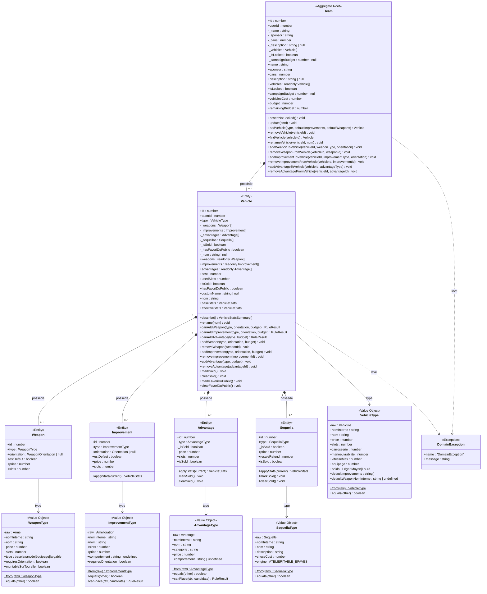
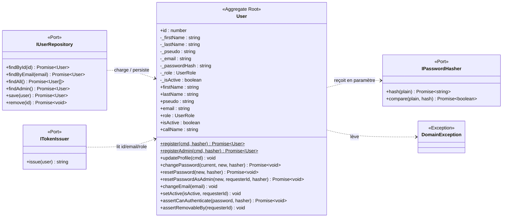
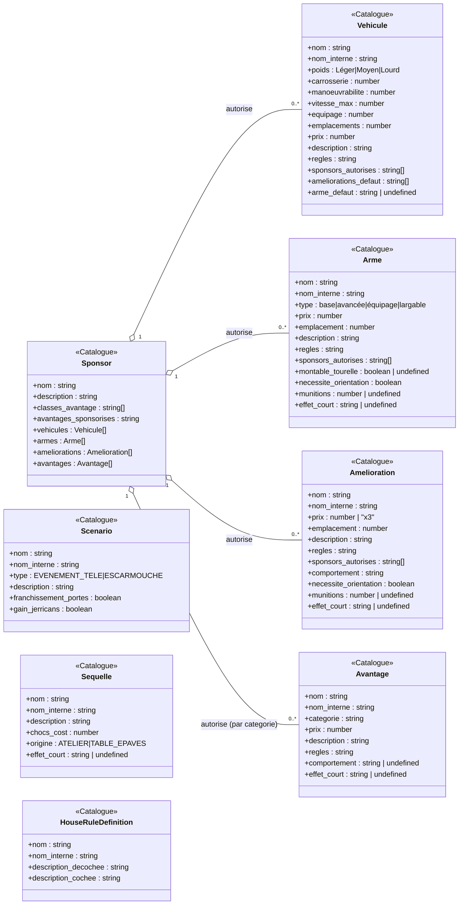
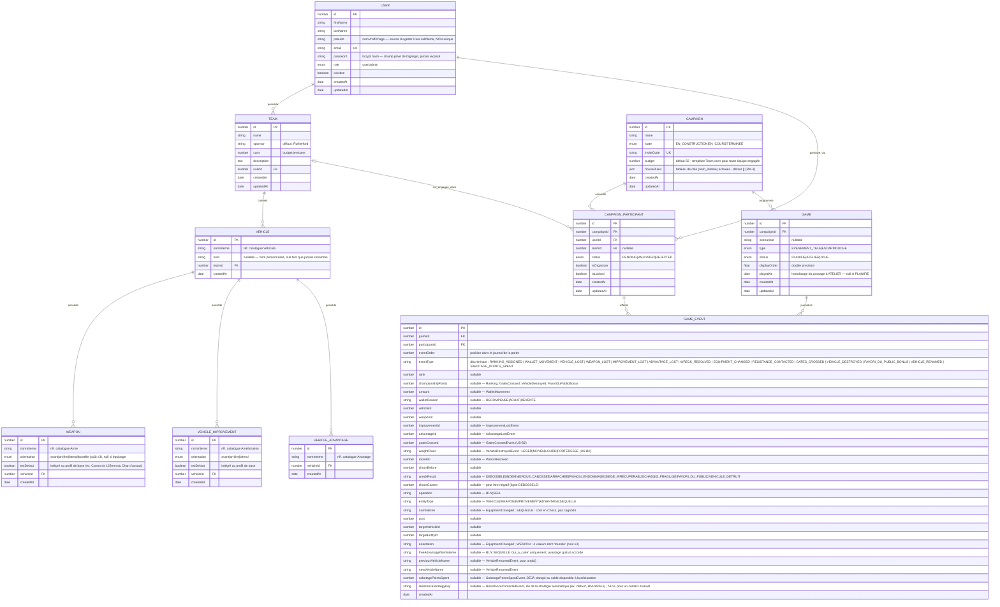
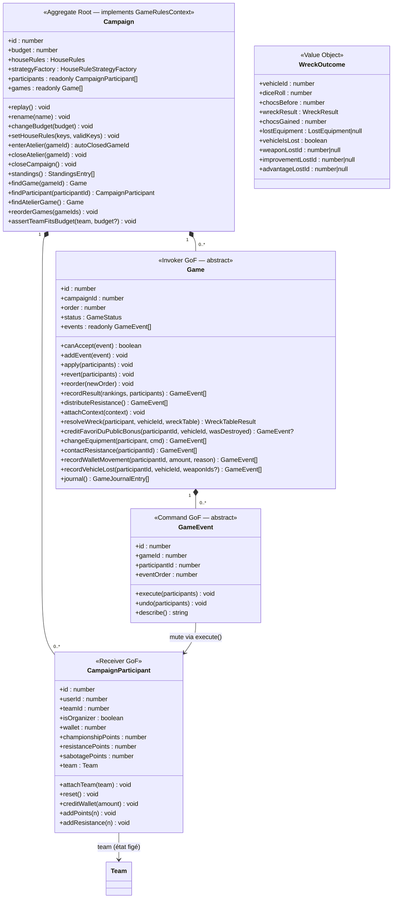

# Gaslands Manager - Modèle du domaine

> **Propriétaire** : conception du domaine (agrégats, qui porte quelle règle, diagrammes).
> Les règles métier elles-mêmes sont dans `docs/spec/` ; ce document y renvoie au lieu de les
> reformuler. Patterns techniques : [ARCHITECTURE.md](ARCHITECTURE.md). Strategy d'équipement :
> [VEHICLE_SYSTEM.md](VEHICLE_SYSTEM.md).

---

## 1. Agrégat Team

`Team` est la racine ; `Vehicle`, `Weapon`, `Improvement`, `Advantage` et `Sequella` sont des entités
enfants dont la racine contrôle le cycle de vie. Les **Value Objects** (`VehicleType`, `WeaponType`,
`ImprovementType`, `AdvantageType`, `SequellaType`) enveloppent les données catalogue et exposent une
API typée.

**Principes de l'agrégat** :
- Toute mutation valide d'abord les règles et lève `DomainException` ; le use case la traduit en 400.
- Coûts et budget calculés en mémoire depuis l'agrégat chargé, jamais en SQL. `Team.budget` est le
  **seul** point qui choisit entre budget de campagne (`_campaignBudget`, hydraté par le repository)
  et `cans` - tous les calculs (`remainingBudget`, `canAdd…`) le lisent ([CAMPAIGN.md - Budget](spec/CAMPAIGN.md#budget-de-campagne)).
- **Verrouillage** : `_isLocked` hydraté par `TeamRepository` (jointure participant → état de campagne,
  aucune colonne). `assertNotLocked()` garde toutes les mutations directes, **pas** les méthodes
  « campagne » (`addCampaignVehicle`, `markWeaponSold`, `renameCampaignVehicle`…) utilisées par le
  replay de l'atelier ([TEAMS.md](spec/TEAMS.md#crud-équipes)).
- **Tourelle** : valeur `'tourelle'` du type `WeaponOrientation = Orientation | 'tourelle'` (distinct de
  l'`Orientation` à 3 valeurs des améliorations) - l'état « orientation + tourelle » est impossible à
  représenter. Réassigner une tourelle = revendre l'arme puis en racheter une, sans code dédié
  ([VEHICLES.md](spec/VEHICLES.md#montage-sur-tourelle)).
- **Orientation requise** : lue du champ catalogue `necessite_orientation` par `WeaponType`/
  `ImprovementType.requiresOrientation`, gardée génériquement par `canAddWeapon`/`canAddImprovement`.
- **Stats effectives et validation de pose** : Strategy `EquipmentBehavior` ; `canPlace()` porté par
  le Value Object (un candidat n'a pas d'instance), `applyStats()` par l'entité montée
  ([VEHICLE_SYSTEM.md §4](VEHICLE_SYSTEM.md#4-pattern-strategy---equipmentbehavior)).
- **Revente** : `isSold` sur `Weapon`/`Improvement`/`Advantage`/`Sequella`/`Vehicle`. Le prix résiduel
  est porté par le getter `price` de chaque entité (`ceil(prix/2)` pour arme, amélioration et châssis ;
  `Advantage.price` et `Sequella.price` ne varient jamais, ce qui suffit à porter la perte totale).
  `Vehicle.markSold()` cascade sur l'équipement pas encore vendu et mémorise transitoirement les ids
  cascadés, pour que `clearSold()` (undo) ne dé-marque que ceux-là ([CAMPAIGN.md](spec/CAMPAIGN.md#annulation-dachat-vs-revente)).
- **Séquelles** : miroir d'`Advantage` dont la monnaie est `vehicle.chocs`. Gardes :
  `canAddSequella` (origine, unicité, Chocs), `isSequellaRemovable` (une `TABLE_EPAVES` n'est jamais
  retirable), `canRemoveSequella` (revente fermée sauf `legende_vivante`). Créées uniquement en
  campagne ([CAMPAIGN.md](spec/CAMPAIGN.md#séquelles)).
- **Nom d'instance** : `_nom` nullable ; le getter `nom` résout **et formate** (« Nom (Type) » seulement
  si personnalisé), aucun consommateur ne reformate. `Vehicle.assertValidName` (statique) permet à
  `Game.renameVehicle` de rejeter un nom invalide avant de construire l'événement.

---

## 1 bis. Agrégat User

Agrégat sans entité enfant : sa valeur est de centraliser les règles du compte et le getter `callName`
(seule source du nom affiché, [AUTH.md](spec/AUTH.md#nom-daffichage-callname)).

- `callName` renvoie aujourd'hui `_pseudo` ; le DTO expose aussi le pseudo brut pour le seul
  pré-remplissage du formulaire (même couple que `Vehicle.customName`/`nom`).
- `_role` est `readonly` : seules les fabriques `register()`/`registerAdmin()` le fixent.
- Hachage via le port `IPasswordHasher`, **passé en paramètre** de méthode (jamais stocké) : les règles
  « mot de passe actuel correct », « compte désactivé » vivent dans l'agrégat sans dépendre de bcrypt.
- Seule règle hors agrégat : l'unicité de l'email (exige de connaître les autres utilisateurs),
  portée par la contrainte `unique` PostgreSQL → `ConflictException` dans `UserRepository`.

---

## 2. Catalogue en mémoire

Chargé une fois au démarrage depuis `database_init/data/*.yml` (cf.
[ARCHITECTURE.md §3.3](ARCHITECTURE.md#33-catalogues---singleton-en-mémoire)), aucune entité ORM :
référence immuable enveloppée par les Value Objects (`static from(raw)`).

- Résolution par sponsor : véhicules, armes, améliorations via `sponsors_autorises` ; avantages par
  `categorie ∈ Sponsor.classes_avantage` ; séquelles et règles maison sans aucun lien sponsor.
- `munitions`/`effet_court` : champs purement présentationnels (fiche d'équipe), cf.
  [VEHICLES.md](spec/VEHICLES.md#catalogue-en-mémoire-pas-en-base-de-données).
- `Scenario` et `HouseRuleDefinition` sont chargés par leurs propres services (`ScenarioCatalogService`,
  `HouseRuleCatalogService`).

---

## 3. Diagramme entité-relation (base de données)

- **Clés logiques, sans FK SQL** : tout `nomInterne` (et `GAME.scenarioId`, `GAME_EVENT.freeAdvantageNomInterne`)
  pointe vers le catalogue en mémoire.
- **Pas de table de séquelles** : une séquelle n'existe que par `EquipmentChangedEvent` et comme entité
  transiente (§4).
- **Pas de table de résultats** : le classement est reconstruit depuis les `GAME_EVENT` `RANKING_ASSIGNED`.
- **`GAME_EVENT` est une table plate** : colonnes payload toutes nullable, seules celles du type
  d'événement sont renseignées (évite une hiérarchie STI TypeORM).
- Unique `(CAMPAIGN_PARTICIPANT.campaignId, userId)`.

---

## 4. Domaine campagne (event sourcing)

Code : `apps/backend/src/app/campaign/domain/`. L'état n'est jamais persisté : il est **recalculé par
replay** du journal `game_events` à chaque chargement. Ne pas confondre l'agrégat `Campaign` avec
l'entité `CampaignOrm`.

### Répartition des responsabilités Campaign / Game

- `Campaign` ne porte que ce qui dépasse une partie : navigation (`findGame`, `findParticipant`),
  invariant « un seul atelier » (`findAtelierGame`), replay, cycle de vie, CRUD programme/participants.
- **La construction des événements d'une partie vit sur `Game`** (`recordResult`,
  `distributeResistance`, `resolveWreck`, `creditFavoriDuPublicBonus`, `changeEquipment`,
  `contactResistance`, `recordWalletMovement`, `recordVehicleLost`, `journal()`…). Les use cases
  naviguent (`campaign.findGame(id)`) puis appellent la méthode sur la partie.
- Les `CampaignParticipant` sont passés **en paramètre** (donnée variable à chaque appel) ; la
  configuration stable (règles maison) est attachée par la racine (`attachContext`, ci-dessous).

### Hiérarchie Game (Invoker)

Pas de sous-type atelier : `ATELIER` est un statut (`PLANIFIE → ATELIER → JOUE`). `canAccept(event)`
dépend du statut :

| Statut | Événements acceptés (`EvenementTeleGame` et `EscarmoucheGame`, listes volontairement dupliquées) |
|---|---|
| `PLANIFIE` | RankingAssigned, WalletMovement, VehicleLost, WeaponLost, ImprovementLost, WreckResolved, ResistanceContacted, GatesCrossed, VehicleDestroyed, FavoriDuPublicBonus, SabotagePointsSpent, EquipmentChanged **`SEQUELLE` seulement** (séquelle imposée par la Table des Épaves) |
| `ATELIER` | EquipmentChanged (tout `entityType`), VehicleRenamed |
| `JOUE` | aucun |

### Règles maison : Strategy par point de calcul

Une règle maison ne modifie jamais `Game`/`Campaign` : elle remplace la Strategy résolue pour **un**
point de calcul. Effets fonctionnels : [CAMPAIGN.md - Règles maison](spec/CAMPAIGN.md#règles-maison).

```mermaid
classDiagram
    direction TB

    class GameRulesContext {
        <<Interface étroite>>
        +strategyFactory : HouseRuleStrategyFactory
    }

    class Campaign {
        <<Aggregate Root — implements GameRulesContext>>
        +houseRules : HouseRules
        +strategyFactory : HouseRuleStrategyFactory
    }

    class Game {
        <<Invoker GoF — abstract>>
        -_context : GameRulesContext | null
        +attachContext(context) void
        #context : GameRulesContext
        +distributeResistance() GameEvent[]
        +recordResult(rankings, participants) GameEvent[]
        +rollBaseIncome(participantId, randomizer) GameEvent[]
    }

    class HouseRuleStrategyFactory {
        <<Abstract Factory — unique, une méthode par point de calcul>>
        -rules : HouseRules
        +createResistanceDistributionStrategy() ResistanceDistributionStrategy
        +createTvBonusDistributionStrategy() TvBonusDistributionStrategy
        +createBaseIncomeStrategy() BaseIncomeStrategy
        +createJerricanGainsCapStrategy() JerricanGainsCapStrategy
    }

    class ResistanceDistributionStrategy {
        <<Interface>>
        +key : string
        +isEligible(entry, context) boolean
    }

    class DefaultResistanceStrategy {
        +key : "defaut"
        +isEligible(entry, context) boolean
    }

    class NoChampionshipPointsStrategy {
        +key : "distribution_points_resistance"
        +isEligible(entry, context) boolean
    }

    class TvBonusDistributionStrategy {
        <<Interface>>
        +key : string
        +isEligible(entry) boolean
    }

    class NoTvBonusStrategy {
        +key : "defaut"
        +isEligible(entry) boolean
    }

    class CollectiveTvBonusStrategy {
        +key : "cagnotte_collective_evenement_tele"
        +isEligible(entry) boolean
    }

    class BaseIncomeStrategy {
        <<Interface>>
        +key : string
        +roll(randomizer) number | null
    }

    class DefaultBaseIncomeStrategy {
        +key : "defaut"
        +roll(randomizer) number
    }

    class NoBaseIncomeStrategy {
        +key : "escarmouche_bonus_jerricans"
        +roll(randomizer) null
    }

    class JerricanGainsCapStrategy {
        <<Interface>>
        +key : string
        +clamp(requestedAmount, alreadyEarned) number
    }

    class UnlimitedJerricanGainsStrategy {
        +key : "defaut"
        +clamp(requestedAmount, alreadyEarned) number
    }

    class CappedJerricanGainsStrategy {
        +key : "plafond_jerricans_escarmouche"
        +clamp(requestedAmount, alreadyEarned) number
    }

    Campaign ..|> GameRulesContext
    Campaign "1" *-- "0..*" Game : attachContext() à la construction/hydratation
    Game --> GameRulesContext : context (jamais Campaign entière)
    GameRulesContext --> HouseRuleStrategyFactory : strategyFactory
    HouseRuleStrategyFactory --> ResistanceDistributionStrategy : résout (distributeResistance)
    HouseRuleStrategyFactory --> TvBonusDistributionStrategy : résout (recordResult)
    HouseRuleStrategyFactory --> BaseIncomeStrategy : résout (rollBaseIncome)
    HouseRuleStrategyFactory --> JerricanGainsCapStrategy : résout (rollBaseIncome, recordJerricanGains)
    DefaultResistanceStrategy ..|> ResistanceDistributionStrategy
    NoChampionshipPointsStrategy ..|> ResistanceDistributionStrategy
    NoTvBonusStrategy ..|> TvBonusDistributionStrategy
    CollectiveTvBonusStrategy ..|> TvBonusDistributionStrategy
    DefaultBaseIncomeStrategy ..|> BaseIncomeStrategy
    NoBaseIncomeStrategy ..|> BaseIncomeStrategy
    UnlimitedJerricanGainsStrategy ..|> JerricanGainsCapStrategy
    CappedJerricanGainsStrategy ..|> JerricanGainsCapStrategy
```

- **`GameRulesContext`** : interface étroite que `Campaign` attache à chaque `Game` (`attachContext`),
  pour que la partie résolve sa politique sans recevoir l'agrégat entier ni une décision d'un use case.
- **`HouseRuleStrategyFactory`** : Factory **unique**, une méthode `create…Strategy()` par point de
  calcul. Reconstruite à chaque accès à `Campaign.strategyFactory` (pas de cache à invalider après
  `setHouseRules`). Registre pur `HOUSE_RULE_REGISTRY` (union discriminée par `point`, Strategy typée
  sans `any`). Deux règles actives sur le même point → `DomainException`.
- **4 points de calcul** :

| Point | Consommé par | Défaut | Règle maison |
|---|---|---|---|
| Distribution des PR | `EvenementTeleGame.distributeResistance()` (un `isEligible` par participant) | `DefaultResistanceStrategy` | R1 `NoChampionshipPointsStrategy` |
| Cagnotte télé | `Game.recordResult()` | `NoTvBonusStrategy` | R2 `CollectiveTvBonusStrategy` |
| Revenu de base | `Game.rollBaseIncome()` (`roll()` → montant ou `null`) | `DefaultBaseIncomeStrategy` | R3 `NoBaseIncomeStrategy` |
| Plafond de gains | `rollBaseIncome()` **et** `recordJerricanGains()` (`clamp(demandé, déjàGagné)`) | `UnlimitedJerricanGainsStrategy` | R4 `CappedJerricanGainsStrategy` |

- La `key` de la Strategy est stampée sur l'événement (ex. `ResistanceContactedEvent.strategyKey`) :
  le résultat est figé, jamais recalculé au replay.
- Le cumul « déjà gagné » de R4 est recalculé depuis `this.events` via le getter générique
  `GameEvent.recompenseJerricansAwarded` (même idiome que `championshipPointsAwarded`), jamais mémorisé.
- **Qui sélectionne** : toujours `Game` via `this.context.strategyFactory`, jamais un use case
  ([ARCHITECTURE.md §3.4](ARCHITECTURE.md#34-architecture-ddd---standard-du-projet)).

### Hiérarchie GameEvent (Command)

Chaque événement implémente `execute()`/`undo()` et `describe()` (une ligne de texte, utilisée par le
journal et l'écran Résolution du wizard).

| Événement | `execute()` | `undo()` |
|---|---|---|
| `RankingAssignedEvent`, `GatesCrossedEvent` | `addPoints(+PC)` | inverse |
| `VehicleDestroyedEvent` | `addPoints(+PC)` au destructeur, ne touche pas le véhicule | inverse |
| `WalletMovementEvent` | `creditWallet(amount)` | inverse |
| `VehicleLostEvent` / `WeaponLostEvent` / `ImprovementLostEvent` / `AdvantageLostEvent` | `markLost()` | `clearLost()` |
| `WreckResolvedEvent` | `addChocs(n)` (n peut être négatif) ; `markFavoriDuPublic()` si ce résultat | inverse |
| `EquipmentChangedEvent` (hors `SEQUELLE`) | BUY : crée l'entité (`addCampaign…`) ; SELL : `markSold…` | inverse |
| `EquipmentChangedEvent` (`SEQUELLE`) | BUY : `addChocs(-coût)` + séquelle (+ avantage gratuit si Dur à Cuire) ; SELL : séquelle (et avantage lié) vendus | inverse |
| `ResistanceContactedEvent` | `addResistance(+3)` | inverse |
| `FavoriDuPublicBonusEvent` | `addPoints(+5)` + `clearFavoriDuPublic()` | inverse |
| `VehicleRenamedEvent` | `renameCampaignVehicle(newName)` | `renameCampaignVehicle(previousName)` |
| `SabotagePointsSpentEvent` | `addResistance(-3 × pointsSpent)` (montant déjà clampé à la construction) | inverse |

Les montants dérivés d'une règle (PC selon le poids, clamp, éligibilité Favori du Public…) sont
calculés par `Game` **avant** la construction de l'événement, jamais dans `execute()`.

### Entités transientes (D-S11)

Véhicules, armes, améliorations, avantages et séquelles achetés en atelier n'ont **pas de ligne en
base** : identité `id = -event.id`, recréés à chaque replay par `EquipmentChangedEvent.execute()`. Les
ids positifs restent aux entités persistées (aucune table pour `Sequella`).
- Dur à Cuire : séquelle et avantage gratuit partagent `-event.id` sans collision (collections distinctes).
- Équipement intégré d'un véhicule acheté en atelier : le véhicule garde `-event.id` (contrat utilisé
  par `findSameSessionPurchase`/`collectSessionEventsForVehicle`) ; ses entités par défaut reçoivent un
  id décalé d'un offset constant (`Team.DEFAULT_IMPROVEMENT_ID_OFFSET`/`DEFAULT_WEAPON_ID_OFFSET`,
  10/20 milliards), supérieur à la capacité de `GAME_EVENT.id` (`integer`) : collision impossible.

### Séquelles (event sourcing)

- Aucun événement dédié : `EquipmentChangedEvent`, `entityType: SEQUELLE`, seule exception où la
  monnaie est `vehicle.chocs` au lieu de la cagnotte.
- Maintenu par la Rouille / Légende Vivante : pas d'événement, deux modificateurs de `WreckTable` lus
  par présence (`Vehicle.hasActiveSequella`) à chaque tirage.
- `WreckTable` dépend d'`ICatalogRepository` (séquelles imposées) en plus d'`IRandomizer`.
