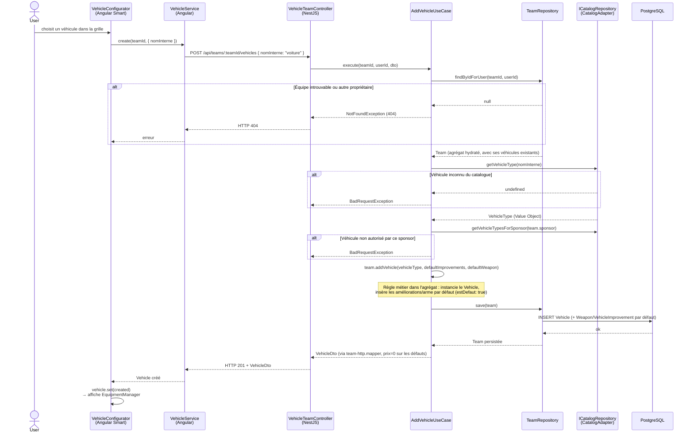
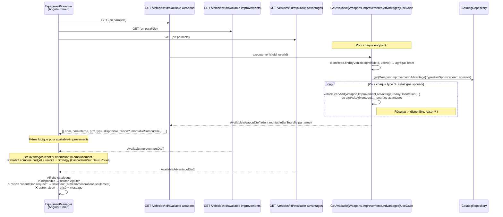
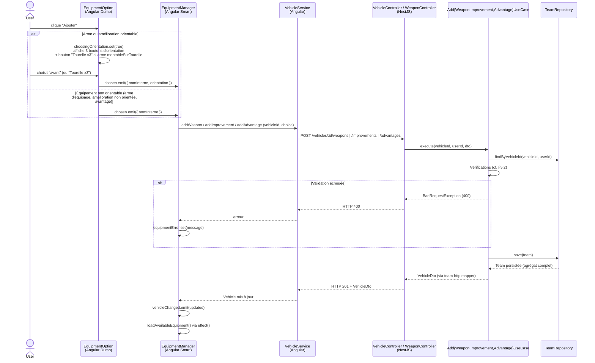
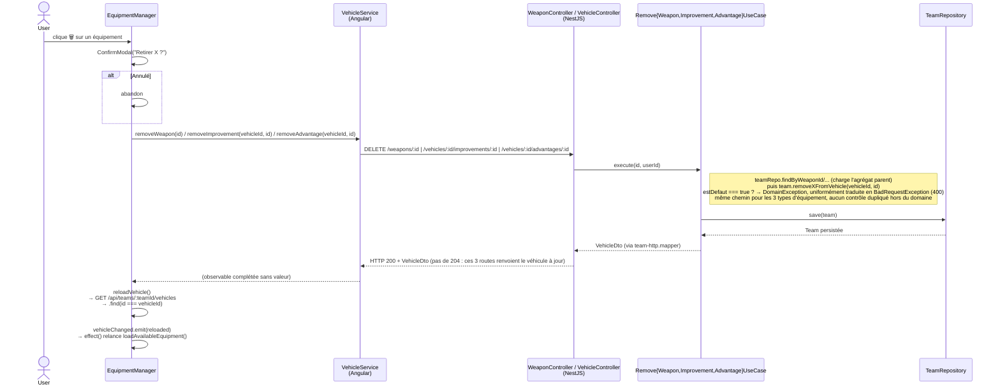

# Système véhicules / équipement - flux et Strategy

> **Propriétaire** : flux d'appels du module `team/` (création, ajout, retrait d'équipement), ordre
> des vérifications, et Strategy `EquipmentBehavior`. Règles du jeu : [spec/VEHICLES.md](spec/VEHICLES.md) ;
> diagramme de classes et ERD : [DOMAIN_MODEL.md §1](DOMAIN_MODEL.md#1-agrégat-team) ; couches DDD :
> [ARCHITECTURE.md §3.4](ARCHITECTURE.md#34-architecture-ddd---standard-du-projet).

---

## 1. Catalogue vs instances de jeu

|                | Catalogue                                    | Instances de jeu              |
| -------------- | -------------------------------------------- | ----------------------------- |
| Source         | YAML `database_init/data/`                   | PostgreSQL                    |
| Chargement     | une fois au démarrage                        | à chaque requête              |
| Mutabilité     | jamais modifié                               | créé/supprimé par les joueurs |
| Représentation | `Map<string, Sponsor>` dans `CatalogService` | entités de l'agrégat `Team`   |
| Identifiant    | `nom_interne`                                | `id` auto-incrémenté          |

Les entités persistées ne référencent le catalogue que par `nomInterne` (pas de FK). Plusieurs variantes
(`belier`/`belier_slime`) partagent la même Strategy via le champ catalogue `comportement` (§4.3).

`TeamMapper` (`infrastructure/team.mapper.ts`) est le seul point qui traduit ORM → domaine : il résout le
Value Object de chaque entité dès sa construction via `ICatalogRepository` (pas d'hydratation après
coup). Un `nomInterne` inconnu du catalogue fait échouer le mapping bruyamment (fail-fast).

---

## 2. Création d'un véhicule

Un véhicule est créé « nu », puis équipé. Le sponsor est vérifié par le use case (l'agrégat ne le connaît
pas), l'équipement intégré est inséré par `Team.addVehicle()`.



---

## 3. Ajout d'un équipement

### 3.1 Disponibilités (GET)

`EquipmentManager` charge en parallèle les trois listes avec verdict (`disponible`, `raison`).



### 3.2 Ordre des vérifications (CRITIQUE)

Réparti sur deux couches ; l'ordre garantit des messages d'erreur cohérents.

**Use case** (`Add{Weapon,Improvement,Advantage}UseCase`) : 1. type inconnu du catalogue → 400 ; 2. type non autorisé pour le sponsor de l'équipe → 400 ; 3. délégation à l'agrégat.

| Ordre | `canAddWeapon`                                         | `canAddImprovement`                                            | `canAddAdvantage`                               |
| ----- | ------------------------------------------------------ | -------------------------------------------------------------- | ----------------------------------------------- |
| 1     | véhicule perdu/vendu                                   | véhicule perdu/vendu                                           | véhicule perdu/vendu                            |
| 2     | Tourelle demandée sur une arme non `montable_tourelle` | budget                                                         | budget                                          |
| 3     | budget (×3 si Tourelle)                                | emplacements (capacité **effective**, §5)                      | unicité                                         |
| 4     | emplacements                                           | orientation requise manquante                                  | Strategy `canPlace` (Cascadeur, Sur Deux Roues) |
| 5     | cohérence orientation / `necessite_orientation`        | Strategy `canPlace` (incompatibilités, unicité, équipage max…) | -                                               |

**Le budget passe avant les emplacements** : sinon un équipement trop cher **et** sans place afficherait
un message trompeur sur les emplacements.

### 3.3 Ajout effectif (POST)



---

## 4. Pattern Strategy - `EquipmentBehavior`

Chaque comportement de jeu est une petite classe **stateless**, une instance singleton par registre,
invoquée par `Vehicle` sur l'état qu'il fournit. Fichiers :
[`domain/behaviors/equipment-behavior.ts`](../apps/backend/src/app/team/domain/behaviors/equipment-behavior.ts)
(contrat, base, `VehicleStats`, `PlacementContext`) et `improvement-behaviors.ts`, `advantage-behaviors.ts`,
`sequella-behaviors.ts`.

```mermaid
classDiagram
    class EquipmentBehavior {
        <<interface>>
        +applyStats(current) VehicleStats
        +canPlace(ctx, candidate) RuleResult
    }

    class EquipmentBehaviorBase {
        <<abstract>>
        +applyStats(current) VehicleStats  "identité par défaut"
        +canPlace(ctx, candidate) RuleResult  "ok() par défaut"
    }

    class ChenillesBehavior {
        +applyStats  "vitesse_max-1, manoeuvrabilite+1"
        +canPlace    "unique ; incompatible char_assaut/helicoptere/gyrocoptere"
    }

    class BelierBehavior {
        +canPlace    "unique PAR ORIENTATION (lit candidate.orientation)"
    }

    class BelierExplosifBehavior {
        +canPlace    "poids Léger interdit ; unique par véhicule"
    }

    class MembreEquipageBehavior {
        +applyStats  "equipage+1"
        +canPlace    "max = 2x equipage initial (baseStats), testé sur l'effectif+candidat"
    }

    class BlindageBehavior {
        +applyStats  "carrosserie+2"
        "aucun canPlace propre - cumulable sans limite"
    }

    class MishkinExclusifBehavior {
        +canPlace    "unique par véhicule"
    }

    class RemorqueMoyenneBehavior {
        +applyStats  "emplacements+1"
        +canPlace    "poids Léger interdit ; une seule remorque (toutes comportements confondus)"
    }

    class RemorqueLourdeBehavior {
        +applyStats  "emplacements+3"
        +canPlace    "poids Lourd requis ; une seule remorque"
    }

    class NeutralEquipmentBehavior {
        "aucun override - comportement par défaut, sans effet ni règle propre"
    }

    class ExpertiseBehavior {
        +applyStats  "manoeuvrabilite+1"
    }

    class CascadeurBehavior {
        +canPlace  "poids Leger/Moyen requis, manoeuvrabilite EFFECTIVE >= 3"
    }

    class SurDeuxRouesBehavior {
        +canPlace  "manoeuvrabilite EFFECTIVE >= 3, tout poids"
    }

    class SequellaBehavior {
        <<interface, plus étroite>>
        +applyStats(current) VehicleStats
        "PAS de canPlace - une séquelle n'est jamais validée via ce mécanisme"
    }

    EquipmentBehavior <|.. EquipmentBehaviorBase
    EquipmentBehaviorBase <|-- ChenillesBehavior
    EquipmentBehaviorBase <|-- BelierBehavior
    EquipmentBehaviorBase <|-- BelierExplosifBehavior
    EquipmentBehaviorBase <|-- MembreEquipageBehavior
    EquipmentBehaviorBase <|-- BlindageBehavior
    EquipmentBehaviorBase <|-- MishkinExclusifBehavior
    EquipmentBehaviorBase <|-- RemorqueMoyenneBehavior
    EquipmentBehaviorBase <|-- RemorqueLourdeBehavior
    EquipmentBehaviorBase <|-- NeutralEquipmentBehavior
    EquipmentBehaviorBase <|-- ExpertiseBehavior
    EquipmentBehaviorBase <|-- CascadeurBehavior
    EquipmentBehaviorBase <|-- SurDeuxRouesBehavior
```



`SequellaBehavior` est volontairement plus étroite (pas de `canPlace`) : une séquelle se valide par
`Vehicle.canAddSequella` (origine, unicité, Chocs), hors de ce mécanisme.

### 4.1 Un seul fold - `Vehicle.effectiveStats`

```typescript
get effectiveStats(): VehicleStats {
  const apresSequellas = this._sequellas
    .filter((s) => !s.isSold)
    .reduce((stats, s) => s.applyStats(stats), this.baseStats);
  const apresAmeliorations = this._improvements
    .filter((i) => !i.isSold && !i.isLost)
    .reduce((stats, i) => i.applyStats(stats), apresSequellas);
  return this._advantages
    .filter((a) => !a.isSold)
    .reduce((stats, a) => a.applyStats(stats), apresAmeliorations);
}
```

Ordre figé **séquelles → améliorations → avantages** : Cascadeur et Sur Deux Roues lisent la
Manœuvrabilité **effective** (après Chenilles, Expertise, séquelles). Tout appelant (validation,
capacité `availableSlots`, affichage) lit cet état complet, jamais un fold partiel.

|                  | Valeur                               | Usage                                                                       |
| ---------------- | ------------------------------------ | --------------------------------------------------------------------------- |
| `baseStats`      | profil catalogue, ne change jamais   | type de véhicule, seuil de `MembreEquipageBehavior`, poids                  |
| `effectiveStats` | profil après tout l'équipement monté | affichage, équipage max, Manœuvrabilité effective, capacité en emplacements |

### 4.2 `canPlace` sur le Type, `applyStats` sur l'instance

| Méthode                    | Portée par                           | Pourquoi                                               |
| -------------------------- | ------------------------------------ | ------------------------------------------------------ |
| `canPlace(ctx, candidate)` | `ImprovementType`/`AdvantageType`    | à la validation, le candidat n'a pas encore d'instance |
| `applyStats(current)`      | `Improvement`/`Advantage`/`Sequella` | ne s'applique qu'à un équipement déjà monté            |

Chacun délègue à la Strategy résolue depuis son propre `comportement` : ni `Vehicle` ni les use cases
n'appellent `resolve…Behavior` directement.

### 4.3 Registres : `comportement` → Strategy

La Strategy est choisie par le champ YAML `comportement`, **indépendamment de `nom_interne`** (variantes
sponsor). Séquelles : `Map` indexée par `nom_interne` (pas de champ `comportement`).

| Famille      | Clé                   | Strategy                     | Stats                         | Règles de pose                                                    |
| ------------ | --------------------- | ---------------------------- | ----------------------------- | ----------------------------------------------------------------- |
| Amélioration | `chenilles`           | `ChenillesBehavior`          | vitesse −1, manœuvrabilité +1 | unique ; interdit sur `char_assaut`, `helicoptere`, `gyrocoptere` |
| Amélioration | `belier`              | `BelierBehavior`             | -                             | unique **par orientation**                                        |
| Amélioration | `belier_explosif`     | `BelierExplosifBehavior`     | -                             | interdit en Poids Léger ; unique par véhicule                     |
| Amélioration | `membre_equipage`     | `MembreEquipageBehavior`     | équipage +1                   | max = 2× équipage de base                                         |
| Amélioration | `blindage`            | `BlindageBehavior`           | carrosserie +2                | cumulable                                                         |
| Amélioration | `mishkin_exclusif`    | `MishkinExclusifBehavior`    | -                             | unique par véhicule                                               |
| Amélioration | `remorque_moyenne`    | `RemorqueMoyenneBehavior`    | emplacements +1               | interdit en Poids Léger ; une seule remorque                      |
| Amélioration | `remorque_lourde`     | `RemorqueLourdeBehavior`     | emplacements +3               | Poids Lourd requis ; une seule remorque                           |
| Avantage     | `expertise`           | `ExpertiseBehavior`          | manœuvrabilité +1             | -                                                                 |
| Avantage     | `cascadeur`           | `CascadeurBehavior`          | -                             | Léger/Moyen, manœuvrabilité effective ≥ 3                         |
| Avantage     | `sur_deux_roues`      | `SurDeuxRouesBehavior`       | -                             | manœuvrabilité effective ≥ 3                                      |
| Séquelle     | `siege_irrecuperable` | `SiegeIrrecuperableBehavior` | équipage réduit               | -                                                                 |
| toutes       | absent                | neutre                       | -                             | - (69/72 avantages, 11/12 séquelles)                              |

L'orientation requise (Bélier, Bélier Explosif) est gardée génériquement par `canAddImprovement`, pas par
la Strategy. L'unicité d'un avantage est portée par `canAddAdvantage` (vraie pour tous les avantages).

### 4.4 Unicité transversale - `PlacementContext.hasComportementAmong`

Une règle qui traverse plusieurs comportements (« une seule remorque », Moyenne **ou** Lourde) : la
Strategy fournit la liste des comportements frères, `Vehicle` fait la recherche
(`hasComportementAmong(comportements)`). `installedCount`/`hasOrientation` suivent le même principe
pour un seul comportement.

---

## 5. Pool d'emplacements partagé

N emplacements **partagés** entre armes et améliorations ; les avantages n'en consomment jamais. N est la
capacité **effective** (`effectiveStats.emplacements`) : les remorques l'augmentent via `applyStats`,
comme n'importe quelle stat.

```typescript
get usedSlots(): number {
  return this._weapons.reduce((s, w) => s + w.slots, 0)
       + this._improvements.reduce((s, i) => s + i.slots, 0);
}
private get availableSlots(): number {
  return this.effectiveStats.emplacements - this.usedSlots;
}
```

- `Weapon.slots`/`Improvement.slots` valent 0 si intégré (`estDefaut`), perdu ou vendu (emplacement libéré).
- Une arme sur **Tourelle** consomme les mêmes emplacements qu'une autre ; seul son prix est ×3 :
  ```typescript
  get price(): number {                     // Weapon
    if (this.estDefaut) return 0;
    const base = this.type.price * (this.orientation === 'tourelle' ? 3 : 1);
    return this.isSold ? Math.ceil(base / 2) : base;
  }
  ```
- Frontend : le total de la jauge vient du DTO (`emplacementsTotal = effectiveStats.emplacements`, dans
  `VehicleDto` et `WorkshopVehicleDto`), jamais recalculé depuis le catalogue (sinon il ignorerait les
  remorques). `EquipmentManager.emplacementsUtilises` reflète `usedSlots` pour un retour immédiat ; la
  vérité reste le backend.

---

## 6. Retrait d'un équipement

Tout équipement acheté est retirable sans revérification (un retrait ne peut pas invalider une
configuration valide). **Sauf l'équipement intégré** (`estDefaut`) : `DomainException` dans l'agrégat →
400, même chemin pour les 3 types.



---

## 7. Sécurité

Ressource inexistante **ou** d'un autre utilisateur → 404, jamais 403 (pas de fuite d'existence). Le
repository filtre `userId` dès le chargement : `findByIdForUser`, `findByVehicleId`, `findByWeaponId` (ces
deux derniers résolvent d'abord le parent, cf. piège TypeORM dans
[ARCHITECTURE.md §3.4](ARCHITECTURE.md#34-architecture-ddd---standard-du-projet)).

---

## 8. Fichiers clés

| Fichier (`apps/backend/src/app/team/`)                                                              | Rôle                                                             |
| --------------------------------------------------------------------------------------------------- | ---------------------------------------------------------------- |
| `domain/team.ts`                                                                                    | agrégat ; types `Orientation`, `WeaponOrientation`, `RuleResult` |
| `domain/vehicle.ts`                                                                                 | `canAdd*`, `usedSlots`, `effectiveStats`                         |
| `domain/weapon.ts`, `improvement.ts`, `advantage.ts`, `sequella.ts`                                 | entités : `price`, `slots`, `applyStats`                         |
| `domain/behaviors/*.ts`                                                                             | Strategy et registres (§4)                                       |
| `domain/value-objects/*-type.ts`                                                                    | Value Objects du catalogue, `canPlace`                           |
| `infrastructure/team.mapper.ts` / `team-http.mapper.ts`                                             | ORM ↔ domaine / domaine → DTO                                    |
| `infrastructure/team.repository.ts`, `catalog.adapter.ts`                                           | persistance, catalogue                                           |
| `team.controller.ts`, `vehicle-team.controller.ts`, `vehicle.controller.ts`, `weapon.controller.ts` | routes                                                           |

| Fichier (`apps/frontend/src/app/teams/vehicle-configurator/`) | Rôle                                                    |
| ------------------------------------------------------------- | ------------------------------------------------------- |
| `vehicle.service.ts`                                          | appels HTTP véhicule/équipement                         |
| `equipment-manager/equipment-manager.ts`                      | listes disponibles, budget, emplacements, ajout/retrait |
| `equipment-option/equipment-option.ts`                        | sélecteur d'orientation (3 arcs + « Tourelle x3 »)      |
| `equipment-manager/mounted-equipment/mounted-equipment.ts`    | équipement monté, badge « (Tourelle) »                  |
| `vehicle-builder.model.ts`                                    | `EquipmentChoice`, `Orientation`, `WeaponOrientation`   |
